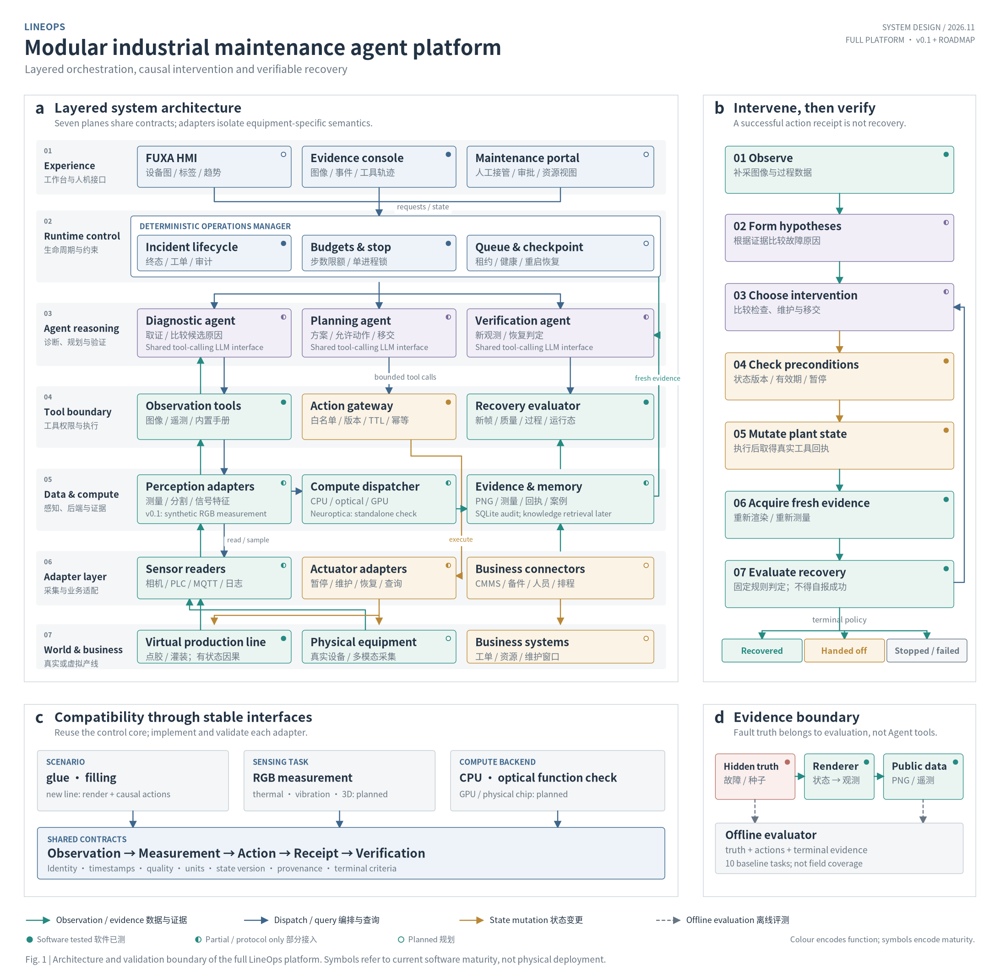

# LineOps Agent Platform

模块化工业设备运维平台，当前交付 v0.1 本机软件沙箱。点胶与灌装两条线共用事件管理、工具网关、执行轨迹、图像证据和恢复判据。

[HTML 架构图](docs/architecture.html) · [完整 Proposal](docs/PROPOSAL.html) · [实施规格](docs/SPECIFICATION.md) · [状态与验证](docs/STATUS.md) · [30 类场景](docs/SCENARIOS.md) · [下一阶段实施计划](docs/NEXT_STEPS.md) · [知识库](docs/knowledge/README.md)

知识库整理自动化实验室论文、工业团队调研、任务评测与研发决策。当前先定义并跑通点胶单场景的真实 Agent、独立评分和最小恢复，再用灌装验证兼容性；参见 [单场景评测](docs/knowledge/evaluation-design.md) 与 [M2 验收](docs/knowledge/m2-plan.md)。这些为待执行方案，不代表新增能力已完成。




[分层、因果与接口说明](docs/ARCHITECTURE.md) · [HTML 交互图](docs/architecture.html) · [矢量 PDF](docs/architecture-full.pdf)

## 运行首版

需要 Python 3.11+，当前测试 Python 3.12。克隆后在仓库根目录执行：

```bash
python -m venv .venv
source .venv/bin/activate
pip install -e .
lineops serve
```

Windows 将激活命令改为 `.venv\Scripts\activate`。打开 http://127.0.0.1:8000，选择产线、注入条件与运行模式。默认离线规则对照不需要模型密钥；它用于复现，不作为真实 LLM Agent 效果。FUXA 是后续并排接入的工业工作台，当前页面是独立证据控制台。

```bash
lineops suite
python -m unittest discover -s tests -v
lineops run --scene filling --fault supply
```

支持 normal / clog / supply / camera / persistent 五种注入。前四种条件在离线套件中结束为 recovered；persistent 保持暂停并建工单，结束为 handed_off。正常条件 recovered 表示通过恢复谓词，无维修动作，不计作成功维修。

## 真实模型工具调用

通过环境变量设置 `LINEOPS_API_KEY`、`LINEOPS_MODEL`，可选 `LINEOPS_LLM_URL`（完整 Chat Completions URL），再选择页面 llm 模式或：

```bash
lineops run --mode llm --scene glue --fault clog
```

配置参见 [.env.example](.env.example)，服务不会自动加载该文件。诊断、规划、验证角色按顺序使用 function tools；真实回执由运行器产生。模型读取图像测量结果和遥测，当前不直接向视觉语言模型发送图片。已验证协议 mock，尚无真实模型端点效果记录。

## 虚拟光学后端与 FUXA

```bash
git submodule update --init --recursive
pip install -e '.[optical]'
lineops optical-check
```

Neuroptica 8 端口 Reck 光学网络通过功能检查。它是独立未训练数值变换，尚未接入缺陷识别决策；不可将此结果解释成真实芯片速度、功耗或识别准确率。不可用时明确返回 numpy_identity fallback，替代变换不宣称等价。

FUXA 和 Neuroptica 固定为 Git 子模块；保留各自 MIT 许可与归属。[FUXA/MQTT 接入草案](docs/FUXA_INTEGRATION.md)包含 Compose 与只读桥接。当前环境没有 Docker，未验证 FUXA 部署、MQTT 传输或标签配置。

## 模块与扩展

- `lineops/simulator.py`：两种场景、状态变更和参数化渲染，隐藏故障不进入工具结果。
- `lineops/runtime.py`：任务生命周期、工具权限、步数预算、动作幂等、维护前暂停与强制复核。
- `lineops/store.py`：SQLite 事件、轨迹、PNG 和工单。重启后未完成任务标记 failed；尚不能恢复世界继续运行。
- `lineops/llm.py`：OpenAI 兼容工具调用，三角色按需读取、执行和验证。
- `lineops/api.py` 与 `static/index.html`：本机 API、操作者注入与证据页。
- `lineops/mqtt_bridge.py`：最近完成事件的只读 MQTT 发布草案。

新产线需实现渲染、测量与故障动作关系，并配置手册和阈值。两条已内置场景可在页面直接切换；首版未实现第三方热加载插件或任意设备仅改配置接入。

## 当前限制与下一步

图像分割采用合成图的 RGB 阈值，不是已训练工业视觉模型；模拟值无真实物理单位，三帧复核不是统计置信度。当前单进程同步运行、设备锁串行执行，没有多设备调度、跨进程锁、真实 PLC/CMMS 或身份认证。只在本机使用；页面显示会等待当前任务完成，停止请求在下一工具边界生效。

下一阶段先完成场景适配最小协议与真实模型基线，将动作账本、检查点和中断恢复提前验收，再联通 FUXA/MQTT，并独立验证光学固定特征任务。详细工作包、依赖、对照实验和验收清单见 [NEXT_STEPS](docs/NEXT_STEPS.md)；长期路线见 [ROADMAP](docs/ROADMAP.md)，六篇自动化实验室论文与设计映射见 [参考文献](docs/AUTONOMOUS_LAB_REFERENCES.md)。

比赛项目 [lineops-agentware-2026](https://github.com/zehaoli0324-cloud/lineops-agentware-2026) 赛前只存文档和第三方指针，不复制本仓库实现。仓库名称暂沿用 LineOps（产线运维）；[命名备选](docs/NAMING.md)。
