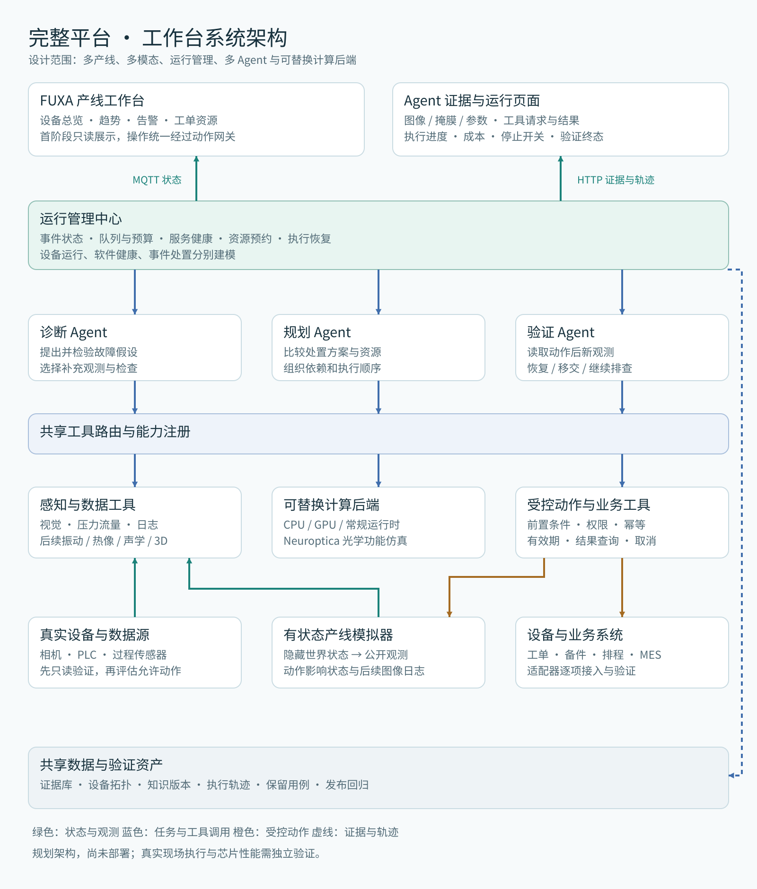
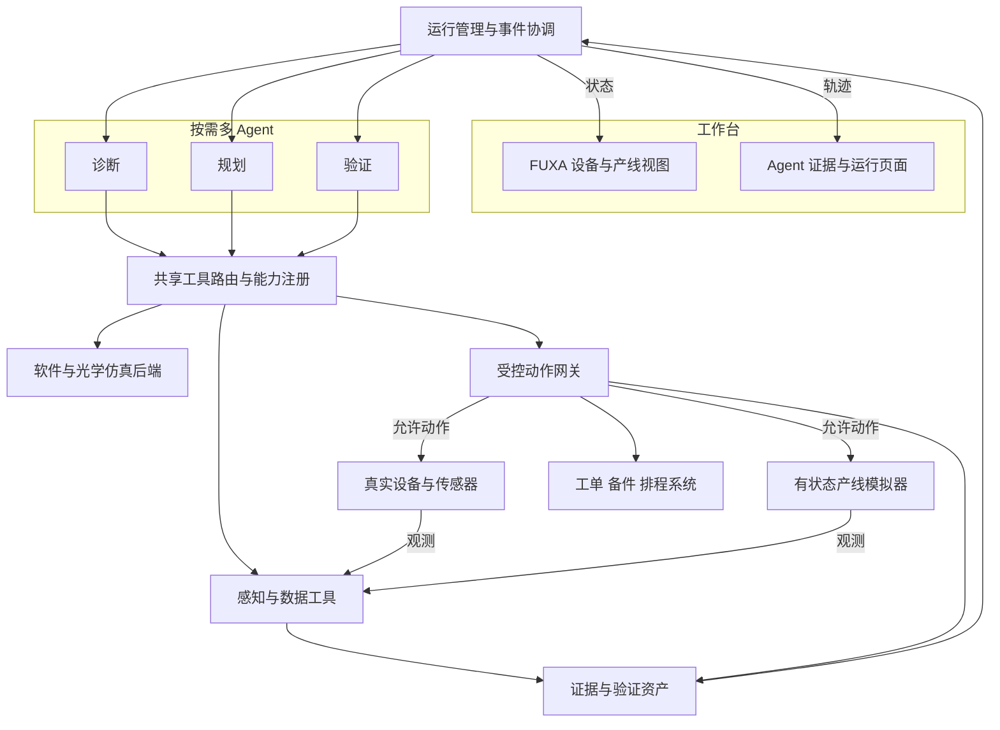

# 当前架构阅读入口

[原生 HTML 交互架构](architecture.html)为当前主版本；[STATUS.md](STATUS.md)说明实现与验证状态。以下 SVG/Mermaid 保留为早期规划快照，不代表部署结果。

# 完整平台工作台系统架构

2026 年 11 月 15 日 · 规划图，不代表已部署或通过测试。

## 可编辑 Mermaid 图

## 边界和主要路径

- FUXA 展示设备状态、过程趋势和事件摘要；Agent 证据页展示图像、工具和终态。
- 运行管理负责状态、队列、健康、预算、动作约束和轨迹；Agent 负责需要证据判断的检查与方案选择。
- 观测和工具结果进入证据通道；动作经统一网关后改变模拟或允许的业务状态，再用新观测验证。
- Neuroptica 是部分小任务的功能仿真后端，不能代表全部视觉流程已映射到芯片，也不提供实体芯片速度证明。
- 完整平台规划真实设备与更多模态；比赛版本仅软件沙盒，第三方原库和原创实现分别记录。
