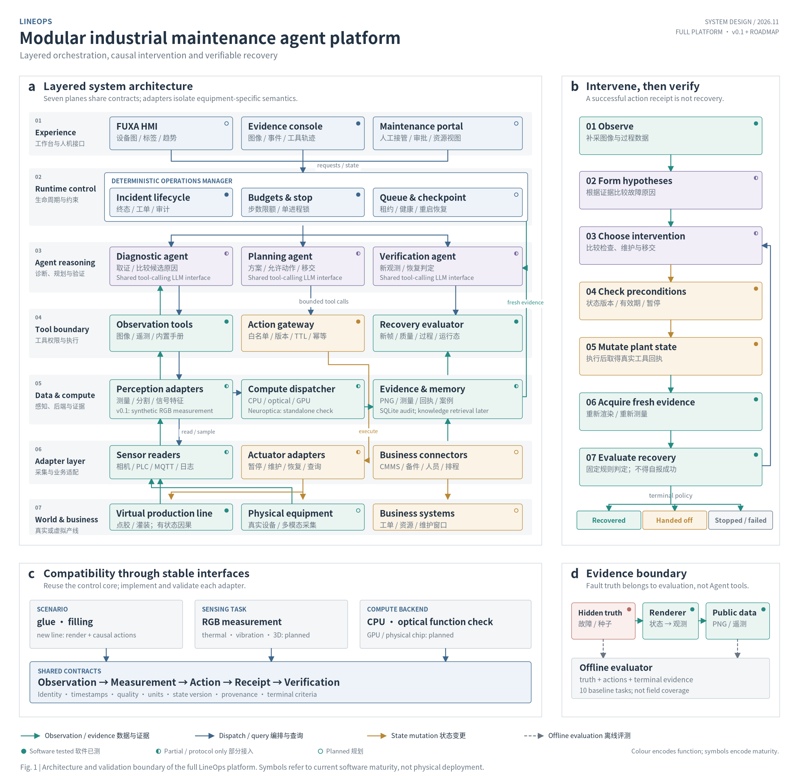

# 完整平台架构：分层、闭环与证据边界

2026-11-16 · Figure 1 · 多面板矢量版

[HTML 交互阅读](architecture.html) · [SVG 矢量源图](architecture-full.svg) · [PDF](architecture-full.pdf) · [PNG 预览](architecture-full.png) · [结构化布局](architecture-layout.json)

## 图中逻辑

- **a 七层架构**：工作台 → 确定性运行管理 → Agent 推理 → 工具权限边界 → 感知计算与证据 → 设备/业务适配 → 产线世界。运行管理内部再分事件生命周期、预算与停止、队列与检查点。
- **b 因果闭环**：观察、候选原因、选择干预、检查前提、改变状态、新观测、复核。工具成功不能直接等同恢复。
- **c 兼容性接缝**：产线、感知任务和计算后端共享观测、测量、动作、回执与验证对象；新设备仍需适配、标定和独立验收。
- **d 真值隔离**：故障真值进入模拟器和离线评估，不进入 Agent 可见工具。Agent 只能依靠图像、遥测与回执完成任务。

实心状态符号代表对应软件路径已测；半实心代表部分接入或仅协议验证；空心代表规划。模型角色尚无真实模型效果记录，FUXA、真实 PLC 和外部 CMMS 尚未部署，Neuroptica 只是独立功能检查。详细状态见 [STATUS.md](STATUS.md)。

## 视觉编码与文件使用

青绿色表示观测与证据，蓝色表示编排与查询，赭黄色表示状态变更，灰色虚线表示离线评测。模块颜色表示职能，状态符号表示成熟度，两者分开阅读。

HTML 内联完整 SVG，没有外部图片或脚本依赖，支持数据流/控制流/动作流高亮、模块解释、缩放和打印。SVG/PDF 可继续编辑或排版；PNG 用于 GitHub 预览。本图采用论文多面板系统图的表达方式，不声称获得期刊认可。旧 Mermaid 文件仅为历史简图，不再作为当前主图。

## 重新生成

在仓库根目录安装 `pip install -e '.[figures]'`，执行 `python scripts/build_architecture.py`，生成完整图的 HTML、SVG、PNG、PDF 和布局 JSON。默认使用 Linux Noto CJK 字体；其他机器可通过 `LINEOPS_FIGURE_FONT` 与 `LINEOPS_FIGURE_BOLD` 指定本机字体文件，并确保 Cairo 的字体解析能识别 Noto Sans CJK SC。Cairo 运行库需由对应系统提供。

如比赛设计文档位于相邻仓库，可用 `--project both`；位置不同使用 `--competition-root <path>`。生成器只在完整项目仓库保存；比赛仓库不复制业务实现或评测代码。

2026-11-16 本次检查：两张图的 SVG/PNG 已渲染并人工检查中文字体、文字边界与连线；HTML JavaScript 语法和 SVG ID 唯一性通过。当前环境仍不能启动 Chromium，因此没有完成浏览器交互截图测试。PDF 已生成，用于后续版面调整。
